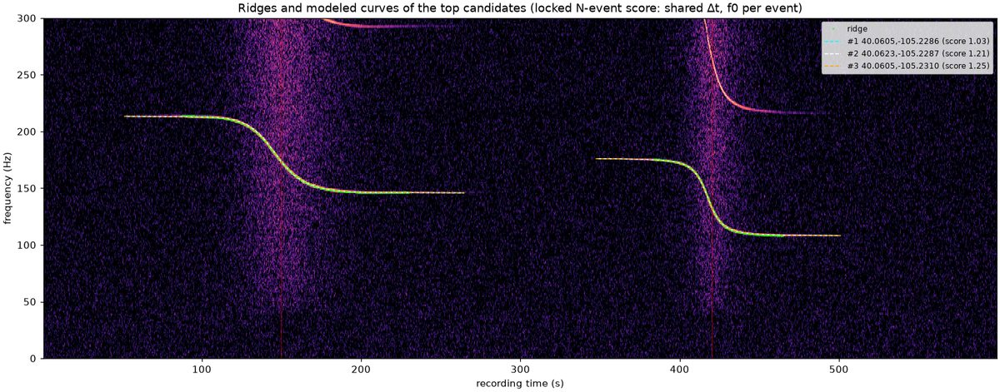
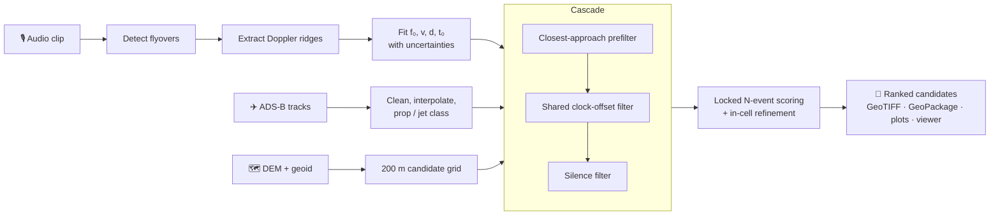
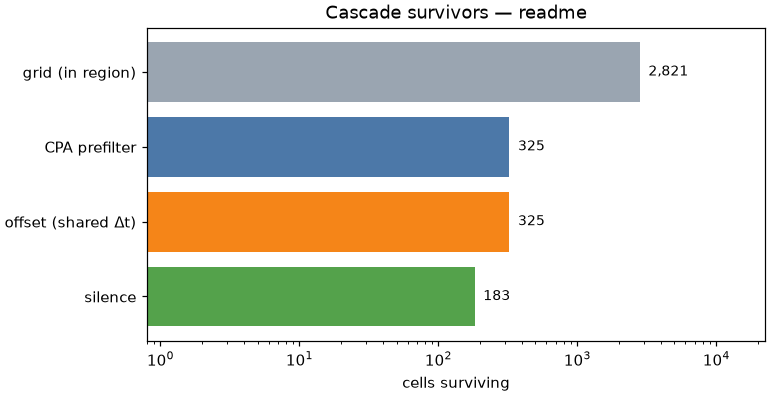

# dopplerfix

**Where was this recorded? Ask the aircraft overhead.**

[](https://github.com/kappy-cone/dopplerfix/actions/workflows/tests.yml)


dopplerfix estimates **where an audio recording was made** from the aircraft audible in its background.
- **The signal:** every flyover leaves a Doppler curve in the spectrogram, a tone that slides down in pitch as
  the aircraft passes.
- **The reference:** public ADS-B flight tracks say where each aircraft was, second by second.
- **The search:** dopplerfix finds the microphone position (and, if needed, the recording's clock offset) whose
  predicted Doppler curves best match the ones heard.



<sub>*A synthetic 10-minute clip with two propeller flyovers. Green: the ridges extracted from the audio. Dashed:
the curves predicted from ADS-B track geometry for the three best candidate locations. Each event has its own
source frequency; all events share one clock offset. The rank-1 location is 36 m from the hidden microphone.*</sub>

---

## The idea

One flyover already constrains the microphone a lot:

| Feature of the curve | What it pins down |
|---|---|
| **Time of closest approach** (corrected for sound travel time) | where along the aircraft's track the mic sits |
| **Steepness at closest approach** | the slant distance to the track; with the aircraft's altitude, the horizontal distance |
| **Frequency swing** | the aircraft's speed, which, with the tone's character (prop vs jet), says which aircraft it could be |

For a straight, level pass at speed *v*, closest distance *d* and closest-approach time *t₀*:

$$
r(t)=\sqrt{d^2+v^2\,(t-t_0)^2},\qquad
f(t)=f_0\,\frac{c}{c+\dot r(t)},\qquad
c\approx 331.3+0.606\,T_{^\circ\mathrm{C}}\ \mathrm{m/s}
$$

- **Narrowing it down:** one event leaves a locus of possible positions. Two events from different aircraft, their
  measured time offset, and the *absence* of other flyovers that should have been heard (the silence constraint)
  narrow it to a few grid cells.
- **Scoring:** uses the general model, not the straight-line formula. The track comes from interpolated ADS-B
  positions. The radial velocity is taken at emission time, and the sound's travel time is included, all in
  ECEF.

## Pipeline



| Stage | What it does | Code |
|---|---|---|
| **Events** | Finds flyover tones, traces each Doppler ridge, and fits speed, distance and closest-approach time, with covariance-based error bars. Labels each event prop or jet. | `detect.py` `ridge.py` `fit.py` `classify.py` |
| **Tracks** | Ingests ADS-B (OpenSky format), removes outliers, splits at gaps, interpolates, and classifies prop/jet from type codes. | `tracks.py` `aircraft_types.py` |
| **Grid** | 200 m cells over a named search region. Ground height comes from a DEM plus a geoid model, so heights compare with GPS altitude. | `geo.py` |
| **Cascade** | Keeps only cells consistent with each event's distance and speed, then with the measured gaps between events under one shared clock offset. Then it rejects cells where an aircraft *should* have been heard but wasn't. It reports how many cells survive each stage. | `cascade.py` |
| **Scoring** | Models every event's curve from real track geometry for each surviving cell, with one shared time shift and a free source frequency per event. Each cell is refined to its best interior point. | `score.py` |
| **Outputs** | Writes `run.json`, `score.tif`, `results.gpkg`, plots and an offline `viewer.html`, plus a QGIS template. | `export.py` `plot.py` `qgis/` |

<p align="center"></p>

## Quick start

Needs Python 3.11+ (developed on 3.12).

```bash
python3 -m venv .venv
.venv/bin/pip install -r requirements.txt
```

Geoid grids (about 19 MB, kept out of git in `data/proj/`):

```bash
.venv/bin/pyproj sync --file us_noaa_g2018u0 --target-directory data/proj
.venv/bin/pyproj sync --file us_nga_egm96_15 --target-directory data/proj
```

Make a synthetic scenario with a hidden microphone, then try to find it:

```bash
.venv/bin/python cli.py synth --clean --seed 0 --event-times 150,420 --duration-s 600 --cascade-decoys 3
```

```bash
.venv/bin/python cli.py locate --scenario outputs/scenarios/synth_seed0
```

`locate` prints the survivors at each stage, the top candidates, and where the true cell ranked. It writes a
run to `outputs/<run_id>/`, and `outputs/latest` points at the newest one.

| File | What it is |
|---|---|
| `run.json` | Config snapshot, events and tolerances, per-stage counts, timings, truth evaluation, disk footprint |
| `results.gpkg` | Candidates, tracks, per-stage survivors and event closest-approach points (EPSG:4326) |
| `score.tif` | Score raster in the grid's own projected CRS (compressed COG) |
| `spectrogram_top.png` `funnel.png` | The two figures above |
| `viewer.html` | Offline comparison viewer. Needs `outputs/plotly.min.js` once: `curl -sSfL -o outputs/plotly.min.js https://cdn.plot.ly/plotly-2.35.2.min.js` |

Open `qgis/doppler_template.qgz` in QGIS to see the latest run on a basemap.

Other commands:

| Command | Purpose |
|---|---|
| `cli.py events` | Detect and fit flyovers in a recording |
| `cli.py tracks` | Ingest, clean and classify ADS-B tracks |
| `cli.py regions` | List or add search regions (`inputs/search_regions.gpkg`) |
| `cli.py ablate` | Paired, resumable ablation runs over the realism layer |
| `cli.py clean` | Prune old runs, keeping the newest N |

Tests:

```bash
.venv/bin/python -m pytest -m "not slow and not heavy" -n 4
```

```bash
.venv/bin/python -m pytest -m "heavy or slow" -n 4
```

The first is the ~30 s gate that CI runs on every push. The second covers end-to-end and scoring checks;
CI runs them after each merge.

## Where it stands

| Milestone | |
|---|---|
| 1–3 Physics; synthetic audio, ridges and fits; ADS-B tracks and classification | ✅ |
| 4 Cascade: grid, prefilter, offset and silence filters, outputs, QGIS template | ✅ |
| 5 Full curve modelling and locked N-event scoring | ✅ on clean synthetic data |
| 4.5 Real-recording calibration (detection, classification, audibility) | 📝 protocol written ([docs/field_recordings.md](docs/field_recordings.md)) |
| 6 Exports and QGIS visualisation | 🔶 exports and template done |
| 7 Real data: regional run, then a US-wide 1-minute benchmark | ⬜ |
| 8 Countermeasures: does high-pass filtering, masking or a phone codec defeat it? | ⬜ |
| 9 Human-in-the-loop guidance, compared with fully automated runs | ⬜ |

**Measured so far** (all synthetic; no real recordings yet):
- **Clean scenarios:** the true cell ranks 1st in every multi-event scenario. The rank-1 estimate is 3–52 m from
  the hidden microphone.
- **Realistic scenarios** (the realism layer fully on, 100 paired seeds):
  - The robust variant puts the right answer at rank 1 in 34 of 100 runs.
  - 21 of 100 are counted correct: within 200 m, and confident enough to claim.
  - 11 of 100 are confidently wrong.
  - Raising those numbers is the current work ([reports/stageA.md](reports/stageA.md)).
- **Detection:** under full realism, 75 of 100 flyovers (seeds 0–49) are detected. A longer-window detection arm reaches
  82 ([reports/u19.md](reports/u19.md)). Proposals for the rest are in
  [docs/u19_detection_literature.md](docs/u19_detection_literature.md).

The realism layer simulates:
- ADS-B degradation;
- engine RPM changes and harmonics;
- atmospheric absorption, ground reflection and wind;
- scene noise (wind, hum, cars, birds);
- realistic traffic geometry.

All validation is fully automated. No manual event windows, no per-clip tuning, and no threshold chosen after
looking at the truth (`reports/apriori_registry.md` records where every threshold comes from).

## Repository map

```
doppler/      pure-function library: physics, audio, detect, ridge, fit, classify, aircraft_types,
              tracks, geo, cascade, score, export, plot, synth, realism, evaluate
cli.py        command-line entry point (all file I/O lives here, in export.py and in plot.py)
config.yaml   every threshold and tolerance; values awaiting real-data calibration are marked PROVISIONAL
inputs/       search regions (GeoPackage)
qgis/         QGIS project template, layer styles and a headless builder
tests/        pytest suite: fast gate, `heavy` and `slow` markers
docs/         design notes: field recordings, OpenSky ingest, UAT coverage, detection literature
reports/      plan, baselines and experiment reports
data/ outputs/   local only (gitignored): geoid grids, DEMs, aircraft DB, runs
```

## Read more

| Document | For |
|---|---|
| [CLAUDE.md](CLAUDE.md) | The authoritative spec: physics, methodology, conventions, known pitfalls |
| [reports/combined_plan.md](reports/combined_plan.md) | The current plan and every recorded decision |
| [reports/stageA.md](reports/stageA.md) | The baseline under full realism, and the U18 result |
| [HANDOFF.md](HANDOFF.md) | Session state: what's done, what's fragile, how to run things |
| [CONTRIBUTING.md](CONTRIBUTING.md) | Branches, reviews, CI policy, multi-session conventions |
| [docs/](docs/) | Field-recording protocol, OpenSky ingest, the pyopensky dependency, UAT coverage, detection proposals |

## Related work

- **Single-microphone flight-parameter estimation from blade-rate Doppler:** Ferguson (JASA 1992), and Ferguson &
  Quinn (JASA 1994).
- **Transit satellite navigation:** a receiver locating itself from a known emitter's Doppler curve, the same
  inverse problem.
- **[Espaye/aircraft-doppler](https://github.com/Espaye/aircraft-doppler):** an independent open-source tool
  with the same goal.

[docs/u19_detection_literature.md](docs/u19_detection_literature.md) reviews these and more.
