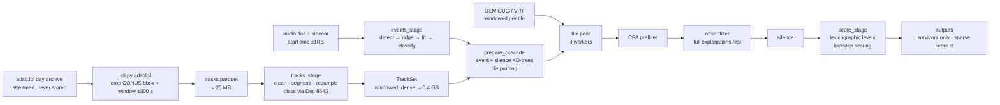

# Design: the US-wide 1-minute benchmark run (milestone 7)

**Status:** proposal, for the owner's review (2026-11-06). Nothing here is built. Numbers marked *est.* are
estimates from stated assumptions. The dry run in §6 replaces them with measurements before any real-audio
claim.

**Reads with:** CLAUDE.md (Search modes; Storage; Known pitfalls "Dense TrackSet" and "Scale"),
[ADR-0004](adr/0004-trackset-memory.md) (TrackSet memory),
[ADR-0005](adr/0005-locate-stage-functions.md) (stage functions),
[ADR-0006](adr/0006-lockstep-centre-scoring.md) (scoring speed, proposed),
[docs/adsblol_ingest.md](adsblol_ingest.md), and [CONTEXT.md](../CONTEXT.md) (timeouts change results).

## 1. Requirements

**Functional.**
- Input: one audio clip of about 1 min with a known start time (±10 s clock prior); ADS-B for the contiguous
  US around that time; a CONUS DEM and the geoid grids.
- Output: ranked candidates with their assigned tracks, Δt and f0 per event; a score raster; per-stage
  survivor counts; diagnostics. This is the same contract as a regional run (`run.json`, `results.gpkg`,
  `score.tif`, `viewer.html`).
- **Success** (CLAUDE.md Validation): the true location ranks 1st. The report gives its rank, the error
  distance, and survivors per stage.
- **Fully automated:** `human_in_loop: false`, no manual windows, no per-clip parameters.

**Non-functional.**
- **Runtime:** under about 1 h on the compute machine (8 cores), so a dry-run sweep of 10–20 clips fits in a
  day. There is no ablation-style 900 s cap: this is one decision-grade run, not a batch.
- **Memory:** under about 8 GB peak.
- **Disk:**
  - inputs cropped, with no whole-day archive kept;
  - outputs written only for cells that survive a stage (CLAUDE.md Storage: never the full grid);
  - a target of under 1 GB per run.
- **Reproducible:** run.json records the commit, config hash, environment (ADR-0001), the input files'
  hashes and the per-stage counts.

**Constraints.**
- Pure functions in `doppler/*`, file I/O only in `cli.py` / `export.py` / `plot.py`.
- Geometry in ECEF float64; every threshold in `config.yaml`.
- V0 and V1 stay runnable. Any result-changing step is an arm (registry rule).
- The provisional thresholds (audibility, jet classification, the sys allowances) are not tuned here. That is
  milestone 4.5.

## 2. Load estimates (*est.*)
| Quantity | Estimate | Basis |
|---|---|---|
| CONUS area | 8.1 M km² | lower 48 states |
| Grid cells at 200 m | about 2.0 × 10⁸ | area / 0.04 km² |
| Tiles (128 × 128 cells, 25.6 km) | about 12,300 | cells / 16,384; `count_grid_cells` switches to the area estimate above 5,000 |
| Airborne aircraft over CONUS at a busy hour | about 5,000–7,000 (assumption) | measured from the adsb.lol day in the dry run (§6) |
| TrackSet window | about 4 min (clip 60 s ± 10 s prior + reach/c + 2 × 60 s pad) | `cli.cascade_inputs` |
| TrackSet memory, dense | about 0.3–0.45 GB | K × 960 samples × 64 B (ADR-0004: fits) |
| Event KD-tree points | about 1–2 M per event | K × (event window ≈ 60 s) × 4 Hz |
| Silence KD-tree points | about 0.6 M | K × 100 s at 1 s decimation |
| Cells within reach of any compatible track (tile pruning, V1) | most busy tiles: about 3,000–8,000 tiles | reach ≈ 12 km event radius + 18 km tile half-diagonal + 5 km margin, around about 2,000+ prop and unknown tracks |
| CPA survivors per event | about 10⁵ cells | about 700 speed-compatible tracks × about 180 cells each (a ±300 m strip either side of about 6 km of track) |
| Cells matching **all** events under one Δt | about 10–10³ | intersection of two event sets, × the timing consistency (Δt pinned to ±2 s) |
| Hypotheses if single-event loci are scored (V1 today) | about 10⁶ | 2 × 10⁵ cells × several hypotheses |
| Scoring cost | about 10 ms per hypothesis | Stage A profile: 69 k hypotheses in about 620–700 s on the compute machine (before #15) |

**The numbers decide the design.** About 10⁶ hypotheses × 10 ms is about 3 h of scoring, almost all of it on
single-event loci. Those cannot be rank 1 whenever any cell explains every event (§3.4). So the plan is to
score full explanations first. Everything else (ingest, the TrackSet, the KD-trees, the per-tile cascade)
fits comfortably.

## 3. Design

### 3.1 Data flow

### 3.2 Tracks: ingest and memory
- **Ingest:** `cli.py adsblol`, streaming the prod day's tar parts into stdin.
  - The crop is the CONUS bounding box + 30 km, and the clip window + 300 s.
  - The whole world-day streams in about 9 min (measured, 2026-11-04). The crop is about 1–2 M fixes,
    about 25 MB of Parquet (*est.*). That fits the storage rules: no archive on disk, Parquet with zstd.
- **Classification is a prerequisite.** Without `aircraft_types.type_table_path` (the Doc 8643 table; an
  open owner item), every track is "unknown" and matches both event classes. The CPA survivors roughly
  double (*est.*). Set it before the dry run.
- **TrackSet stays dense** (ADR-0004, accepted): about 0.4 GB fits. Two required changes:
  - **The window must not grow with the time prior.** The benchmark is "known" mode. In "window" mode, a
    start known only to the day would make T about 345,000 samples, about 130 GB. That case is out of scope;
    see §7.
  - **Log K, T and bytes** in run.json (ADR-0004 action 1), so the dry run measures them.
- **The `_packed` cache** (#15) grows only with the tracks that scoring touches, so it stays small.

### 3.3 Grid, DEM and tile pruning
- **Grid:** EPSG:5070 (Albers), 200 m (`grid.crs: auto` already maps `search.mode: us` to it). It needs a
  `conus` polygon in `inputs/search_regions.gpkg`: Census cartographic boundary, lower 48, simplified to about
  1 km. It is committed, about 100 kB.
- **DEM:** the ground height of a cell only has to be good to about the `height_sys_m` budget (30 m).
  - A 30 m or 90 m DEM is enough for 200 m cells. The options, and the choice for the owner, are in §5 D2.
  - Reads stay windowed per active tile (`cli.RasterDEMSource`), and inactive tiles are never read.
- **Tile pruning today** keeps a tile if at least `required_gating` events have compatible track samples
  within reach. Under V1 (`max_unmatched_events: 1`) that is one of two events, so most busy tiles stay
  active (§2). Under a full-first level (§3.4) the requirement is all events, which cuts active tiles to those
  near traffic for both events (*est.* hundreds to a few thousand).

### 3.4 Cascade and scoring: lexicographic levels ("full explanations first")
Ranking is lexicographic: `CellScore.rank_key = (n_unmatched, cost)`. A cell whose best hypothesis leaves k
events unmatched can never outrank a cell with a hypothesis that leaves fewer. The v1 and v2 tie sets also
take only candidates with rank 1's unmatched count. So:

1. **Level 0:** run the cascade with every gating event required (`required = N`), tiles pruned the same
   way. Score the silence survivors.
   - If any survive, rank 1, the tie set and the status come from them, because no partial hypothesis can
     beat or tie a full one.
   - They match V1-scored-everything **except in two places where today's V1 lets partial hypotheses affect
     full ones:**
     - **(a) the enumeration budget.** `enum_budget_per_cell` counts partial combinations too, so V1 can stop
       before finding all of a cell's full hypotheses, and level 0 may find more of them.
     - **(b) the silence Δt and penalty** are taken at the cell's cascade-best hypothesis, which in V1 can be
       a partial one.
     With `silence_scope: hypothesis` (#23), (b) disappears.
2. **Level k > 0** runs only if level k−1 has no survivor, and only while N − k ≥ 2.
   - With N = 2 that means never: one event is a locus (CLAUDE.md Known pitfalls, Single event).
   - With no full explanation, the run reports status `locus`. Optionally it adds the best partial
     candidates within a fixed budget, as a diagnostic, never as a location claim.

**What changes in results.**
- Rank 1, the Δt, the f0s and the status are expected to match V1-scored-everything on runs with a level-0
  survivor, apart from (a) and (b) above.
- What changes:
  - partial-only cells are not scored, so their `score`, `rank` and `true_cell_rank` become "not scored (lower
    level)";
  - the score raster covers level-0 cells only;
  - runs with no full explanation return `locus`, not a single-event rank 1, which CLAUDE.md already says is
    not meaningful.
- So it is an **arm**. Its first measurement is how often rank 1 differs from V1's on Stage A2 units that
  have a level-0 survivor, and why: (a), (b) or something else, which would be a bug. Then decide it against
  the Stage A2 rows.

**Code shape.**
- One new config key, `cascade.level_mode: all | lexicographic`, with default `all` (today's behaviour).
- The cascade is called once per level with `required` set (the `required_gating` / `max_unmatched_events`
  hooks exist).
- `score_stage` (ADR-0005) loops over levels, using `rank_cells` unchanged.

**Scoring speed** inside a level comes from lockstep centre scoring (ADR-0006, proposed). At level 0 (*est.*
10–10³ cells × up to 64 hypotheses) even today's scorer takes minutes, so ADR-0006 is welcome but not
blocking.

### 3.5 Parallelism
- **Tiles are independent.** CPA, offset and silence need only the read-only setup (KD-trees, the TrackSet,
  the events).
  - Run them on a process pool of `cascade.workers` (new key; default 1 keeps today's behaviour).
  - Send tile origins out and `TileResult` survivors back. Only silence survivors return to the parent; the
    full per-tile arrays never do.
- **Shared read-only data:**
  - The TrackSet arrays go in shared memory or a memmap. The compute machine's OS may not fork, so
    workers must not rely on copy-on-write.
  - The KD-trees are rebuilt per worker from the shared arrays (cKDTree builds in about 1 s for 1–2 M
    points, *est.*), rather than pickled.
- **Determinism:** tiles are processed in a fixed order and their results collected in that order, so
  outputs don't depend on the worker count. A test checks workers = 1 vs 4 for identical survivors and
  ranking.
- **Scoring:** cells are independent too. Score level-0 cells on the same pool, in chunks.
- This is a single run, not an ablation, so `--jobs` contention doesn't apply. If the benchmark is ever run
  inside `ablate`, use workers = 1 there.

### 3.6 Outputs
- **No grid layer** (already so for `mode: us`).
- **The `stage_*` layers** are written only for cells that survive each stage. At US scale `stage_cpa` can be
  about 10⁵ rows (*est.*), about 10–20 MB of GeoPackage, which is acceptable. A cap (`outputs.max_stage_rows`)
  writes a random, reported subset beyond it.
- **score.tif:** level-0 cells only. Above `outputs.max_raster_cells` it is the sparse tiled GeoTIFF that
  already exists, cropped to the survivors' extent.
- **run.json adds:**
  - per-level counts, the active tiles, K, T and TrackSet bytes;
  - the workers;
  - the input hashes: the archive tag and part sizes, the crop Parquet, the DEM VRT;
  - the environment (ADR-0001).

## 4. Failure modes and what the run does about them
| Failure | Effect | Handling |
|---|---|---|
| The event aircraft has no ADS-B (GA without ADS-B out, or a coverage gap) | No level-0 cell; status `locus` or none | Reported, with the survivors per stage. A known limit, not a bug; MLAT is kept (adsblol sources) |
| A decoy aircraft with no ADS-B (unheard aircraft missing from the data) | Silence is weaker; more survivors | Already the probabilistic-silence design; the counts show it |
| Unknown type codes | Class filtering is lost for those tracks | The Doc 8643 table set; the share of unknowns reported |
| Barometric-only tracks | Height error about 150 m allowance | `baro_alt_tol_m`; the share reported |
| DEM read fails for a tile | The tile has NaN heights | The tile is skipped and logged; run.json counts skipped tiles. Never silently dropped |
| A worker crashes | Lost tiles | The pool re-raises; the run fails loudly. No partial result is written as complete |
| Too many level-0 survivors (dense airport area) | Long scoring | Logged per level; ADR-0006; no cap that changes rank 1 without being an arm |

## 5. Decisions for the owner
- **D1. `cascade.level_mode: lexicographic`** (§3.4), as a registered arm. Its expected property: the same
  rank 1 wherever a level-0 survivor exists, apart from the enumeration-budget and silence-Δt differences
  in §3.4. This is the design's main lever.
- **D2. DEM source.**
  1. Download only the 1° tiles of a 30 m or 90 m DEM that active tiles touch, mosaicked as a VRT. This is
     what CLAUDE.md Storage says; about 1–3 GB for CONUS at 90 m (*est.*); each download needs approval.
  2. Windowed remote reads of a public cloud-optimised DEM over HTTP, with a size-capped local cache. Nothing
     is stored whole, but the run needs the network.
  3. A flat-ground approximation. Rejected: the 30 m height budget fails in mountains.
  Recommendation: option 1 at 90 m, because the run then works offline and reproducibly.
- **D3. Doc 8643 type table** (`aircraft_types.type_table_path`). This is already an open item, and is
  needed before the dry run.
- **D4. `cascade.workers`** (§3.5). It is an implementation choice with identical results; it needs only the
  determinism test.
- **D5. Benchmark time prior.** Confirm the 1-minute clip's start is known to about ±10 s. If only the day is
  known, the run is a different design (§7).

## 6. Validation path (before the real clip)
1. **Real-traffic replay dry run** (the plan's P4.3).
   - Take a real adsb.lol hour over CONUS. Inject two synthetic event aircraft with known tracks and a hidden
     mic, and synthesise the audio (`synth` on the injected tracks).
   - The real traffic supplies the density, the decoys and the silence load.
   - Measure K, T, the active tiles, the survivors per stage and level, the time per stage, the memory and
     the disk. These replace every *est.* in §2.
2. **A replay sweep:** 10–20 mic locations (urban, rural, near an airport, in mountains), each fully
   automated. Report rank and error, and the level-0 survivor counts.
3. **Regional run on the same machinery:** a real regional clip (milestone 7's first step) through the same
   code path with `search.mode: regional`, to separate scale effects from real-audio effects.
4. **The benchmark:** only after 1–3. Fully automated, with a smoke run first (CONTRIBUTING §4.1).

## 7. What to revisit as it grows
- **Unknown start time (window mode).** T grows to a day, which breaks the dense TrackSet. It needs
  ADR-0004's time-chunking: the search is chunked over Δt, each chunk with its own TrackSet window.
- **Clips longer than about 10 min:** the same, per ADR-0004.
- **More events (N ≥ 3):** level 1 becomes a real location claim. Budget it like level 0.
- **Score raster at full CONUS resolution:** only if the level-0 sets get large; the sparse tiled path
  exists.
- **Live or near-real-time:** out of scope (CLAUDE.md non-goals).

## 8. Work breakdown (each its own PR; order)
1. ADR-0004 action 1 (log K, T, bytes) and ADR-0001 (the environment in run.json). Small.
2. ADR-0005 stage split: `score_stage` and `cascade_stage`, checked by T2's golden rows. It makes §3.4's
   level loop a small change.
3. The `conus` region and the DEM VRT (D2), plus `cli.py` wiring for a remote-free US run.
4. `cascade.level_mode` (D1): registered, off by default. A test compares its rank 1 with V1's on synthetic
   multi-event scenarios that have a level-0 survivor, and every difference must trace to §3.4 (a) or (b).
5. `cascade.workers` (D4) with the determinism test.
6. The replay dry run (§6.1), then the sweep, then the regional real run, then the benchmark.
